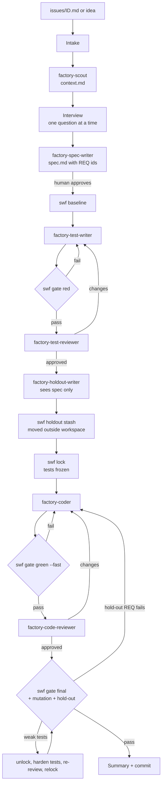

# Copilot Software Factory

A test-driven "software factory" for **existing (brownfield) Python repositories**,
run by **GitHub Copilot custom agents in VS Code**. You give it an idea or an
issue; it interviews you, writes a spec, writes and reviews tests until they are
solid, writes and reviews code until it is sound, then checks the result against
hidden hold-out tests.

LLM agents do the creative work. A small deterministic CLI (`.factory/swf.py`)
decides when each step is actually done.



Every loop calls `swf round`. After `max_rounds` (default 4) it exits with
code 3 and the orchestrator **escalates to you** instead of looping forever.

## Why Copilot custom agents and not CrewAI?

| | Copilot custom agents (used here) | CrewAI / LangGraph |
|---|---|---|
| Runs in | VS Code chat, with your editor, terminal and workspace | Separate Python process |
| LLM access | Your Copilot licence | Separate API keys and billing |
| Human in the loop | Native (`vscode/askQuestions`, chat) | You build it |
| Loop control | Agent instructions + **hard gates in `swf.py`** | Code (LangGraph is strongest here) |
| Unattended / CI runs | Limited | Yes |

Copilot provides the agents, subagents, tool restrictions and the interview UI.
`swf.py` adds what LLM orchestration lacks: deterministic pass/fail, loop
budgets and tamper detection. If you later want unattended runs,
the same gates and specs carry over unchanged to a **LangGraph** service.
LangGraph's explicit state machine suits these loops better than CrewAI's role-play model.

## What's in the box

```
install.py                       copies template/ into a target repo (idempotent)
template/
  .github/
    copilot-instructions.md      always-on rules (merged into an existing file)
    instructions/                python + tests rules, applied by file glob
    agents/
      factory-orchestrator       the one you talk to; no edit tool on purpose
      factory-scout              maps brownfield code, conventions, blast radius
      factory-spec-writer        issue -> spec.md with REQ-nnn + Given/When/Then
      factory-test-writer        characterization + red spec tests; hardening mode
      factory-test-reviewer      sceptical review, recomputes expected values
      factory-holdout-writer     hidden acceptance tests from the spec only
      factory-coder              makes locked tests pass; may not touch tests
      factory-code-reviewer      spec fit, edge cases, consistency, standards
    prompts/                     /factory-start /factory-resume /factory-new-issue /derive-standards
  .factory/
    swf.py                       gate CLI (stdlib only)
    config.toml                  paths, loop budget, quality bars
    templates/                   issue.md, spec.md
  docs/coding-standards.md       Python + quant standards; section 5 is learned from the repo
  issues/                        issue files (EXAMPLE-1.md included)
  specs/                         one folder per issue: spec, context, reviews, gate log, state
tests/                           tests for swf.py and install.py
```

## Setup

Requirements: VS Code with GitHub Copilot (agent mode, custom agents and
subagents enabled in your organisation's Copilot policy), Python ≥ 3.11, git.

```bash
git clone <this repo> ~/copilot-software-factory
python ~/copilot-software-factory/install.py /path/to/your/repo --dry-run   # preview
python ~/copilot-software-factory/install.py /path/to/your/repo
cd /path/to/your/repo
pip install pytest pytest-cov ruff mypy          # into the repo's own environment
```

The installer auto-detects `src_paths`, `test_paths` and the base branch.
Override with `--src`, `--tests`, `--base`. It never overwrites existing
files without `--force`. It appends a marked block to an existing
`.github/copilot-instructions.md` and adds two lines to `.gitignore`.

Then in VS Code Copilot Chat:

1. **`/derive-standards`**: learns your repo's real conventions into
   `docs/coding-standards.md` §5 and checks `.factory/config.toml`.
   Run it once, then occasionally.
2. Write an issue: copy `.factory/templates/issue.md` to `issues/<ID>.md`, or run
   **`/factory-new-issue <idea>`**.
3. **`/factory-start issues/<ID>.md`** (or select the *factory-orchestrator*
   agent and give it the path or an idea).
4. Answer the interview questions. Approve the spec. Then mostly watch; you're
   asked again only on escalation and before committing.
5. Interrupted? **`/factory-resume <ID>`**.

If your VS Code version needs a setting for custom agents to run as subagents,
or the agent picker doesn't show them, check *Chat: Custom Agent in Subagent*
and the agent file locations in the VS Code settings for your version.

## The gates (`python .factory/swf.py ...`)

| Command | Passes when |
|---|---|
| `gate red <ID>` | new spec tests exist, **fail** (import errors allowed, syntax errors not); every `REQ-nnn` in the spec has a test named `test_req_nnn_*`; characterization tests (`test_characterization_*.py`) pass on current code; rest of suite unaffected; ruff clean |
| `lock <ID>` | (records SHA-256 of all changed test files) |
| `gate green <ID> --fast` | locked tests unchanged, none added or deleted; full suite green apart from **baseline** failures; diff coverage of changed lines+branches ≥ 90%; ruff + mypy clean on changed files |
| `gate final <ID>` | green + **mutation score** ≥ 70% on changed lines (built-in AST mutator, no extra dependency) + hold-out tests pass |
| `holdout run <ID>` | hidden tests pass; failures are reported **only** as `REQ-003: 2 hidden check(s) failed` |
| `round <ID> <loop>` | exit 3 after `max_rounds` → escalate; `--reset` after human guidance |
| `trace start/finish/append/log/index` | per agent x iteration trace files (see below) |
| `baseline`, `status`, `changed`, `phase`, `unlock`, `mutation-restore` | housekeeping |

Every gate run is appended to `specs/<ID>/gate-log.md`. Thresholds are in
`.factory/config.toml`.

## Traces: every agent x iteration on disk

Each subagent call produces its own file, e.g.

```
specs/RISK-42/traces/
  index.md                     table: #, agent, loop, round, status, start/finish
  orchestrator.md              interview Q/A, approvals, routing decisions, escalations
  001-scout-r1.md
  002-spec-writer-r1.md
  003-test-writer-r1.md
  004-test-reviewer-r1.md
  005-test-writer-r2.md        2nd tests round after review feedback
  ...
  011-coder-r3.md
```

A trace file has fixed sections, filled by two parties so it doesn't depend
only on the agent's own diligence:

| Section | Written by | Content |
|---|---|---|
| Header | `swf trace start` | agent, loop, round, phase, timestamps, status |
| Input | orchestrator via `swf trace start` (stdin) | the exact task text sent |
| Inputs read | agent | files + line ranges, command outputs relied on |
| Reasoning and decisions | agent | interpretation, options considered, choice and why, assumptions, doubts |
| Actions | agent | chronological edits and commands with key results |
| Output | orchestrator via `swf trace finish` | the agent's complete reply |
| Gate: ... | orchestrator via `swf trace append` | gate output that followed the call |

The hold-out writer's trace is moved outside the workspace along with its
tests. The index shows it as hidden.

"Reasoning" here is the agent's **written rationale**, not the model's hidden
internal reasoning, which Copilot doesn't expose. For raw request/response logs
of a session, use VS Code's chat debug and export features alongside these traces.

Using traces to tune the factory:

- Rounds per loop and the reviewer's "Must fix" items across specs show which
  agent instructions are underspecified. Fix the `.agent.md`, not the symptoms.
- Compare *Inputs read* with what the agent should have read, to catch missed
  context or token-wasting over-reading.
- Hold-out failures plus the coder's reasoning show whether the spec or the
  coder was at fault.

## Design notes, and what was added beyond your original list

- **Codebase scout + characterization tests.** In a brownfield repo the
  first risk is breaking what already works. The scout maps callers; the
  test writer pins current behaviour before anything changes.
- **Baseline.** Legacy suites often have red tests. They're recorded up front
  so they don't block the factory or get blamed on the new work.
- **Objective test quality.** Reviewer opinion is backed by numbers:
  every REQ is traced to a test, diff coverage, and mutation score on the
  changed lines. Surviving mutants trigger a *hardening* loop for the
  **tests**, not the code.
- **Test lock.** The coder can't make the build pass by editing the tests.
  The gate checks file hashes rather than relying on the prompt.
- **Hold-outs with information hiding.** Hidden tests come from an agent that
  sees only the spec. They're stored in `~/.factory-holdout/<repo>/<ID>/`, and
  failures surface only as requirement IDs, so the coder fixes behaviour
  rather than overfitting to specific cases.
- **Loop budgets + escalation.** Each loop has a round budget; when it runs
  out, the orchestrator asks you instead of looping forever.
- **File-based memory.** Specs, reviews, gate logs, state and per-agent
  traces live in `specs/<ID>/`. Runs can be resumed, audited, optimised and
  committed with the code.
- **Role separation via tool restrictions.** The orchestrator can't edit
  files; the hold-out writer can't run anything; reviewers write only
  review files.
- **Model diversity (optional).** Each reviewer file has a commented `model:`
  line. Using a different model family for writer and reviewer catches more problems.

### Known limits

- Hold-out isolation is *soft*: the coder has a terminal and could read
  `~/.factory-holdout`. Its instructions forbid it, and the coder only receives
  requirement-level summaries. For hard isolation, keep hold-outs in a separate
  repo and run `swf holdout run` in CI only.
- Agent instructions that restrict *which* files an agent edits (e.g. "reviews
  only") are enforced by prompt. The important one, test tampering, is
  enforced by the gate. VS Code agent hooks (preview) can turn more of these
  rules into hard blocks.
- Mutation testing re-runs the locked tests per mutant. Large suites: lower
  `mutation_max_mutants`, or add `pytest-xdist` via `pytest_args`.

## Roadmap

- Jira / GitLab ingestion: an MCP server (Atlassian remote MCP, GitLab MCP) in
  `.vscode/mcp.json` plus an intake step writing `issues/<ID>.md` in the
  same format; post the spec and result back as a comment / MR.
- CI: run `swf gate final <ID>` in the merge-request pipeline so the gate
  is enforced outside the IDE too.
- Hooks: block the coder from editing test paths at tool-call time.

## Developing the factory

```bash
pip install pytest pytest-cov ruff mypy
pytest            # end-to-end flow on a generated brownfield repo
ruff check . && ruff format --check . && mypy
```
